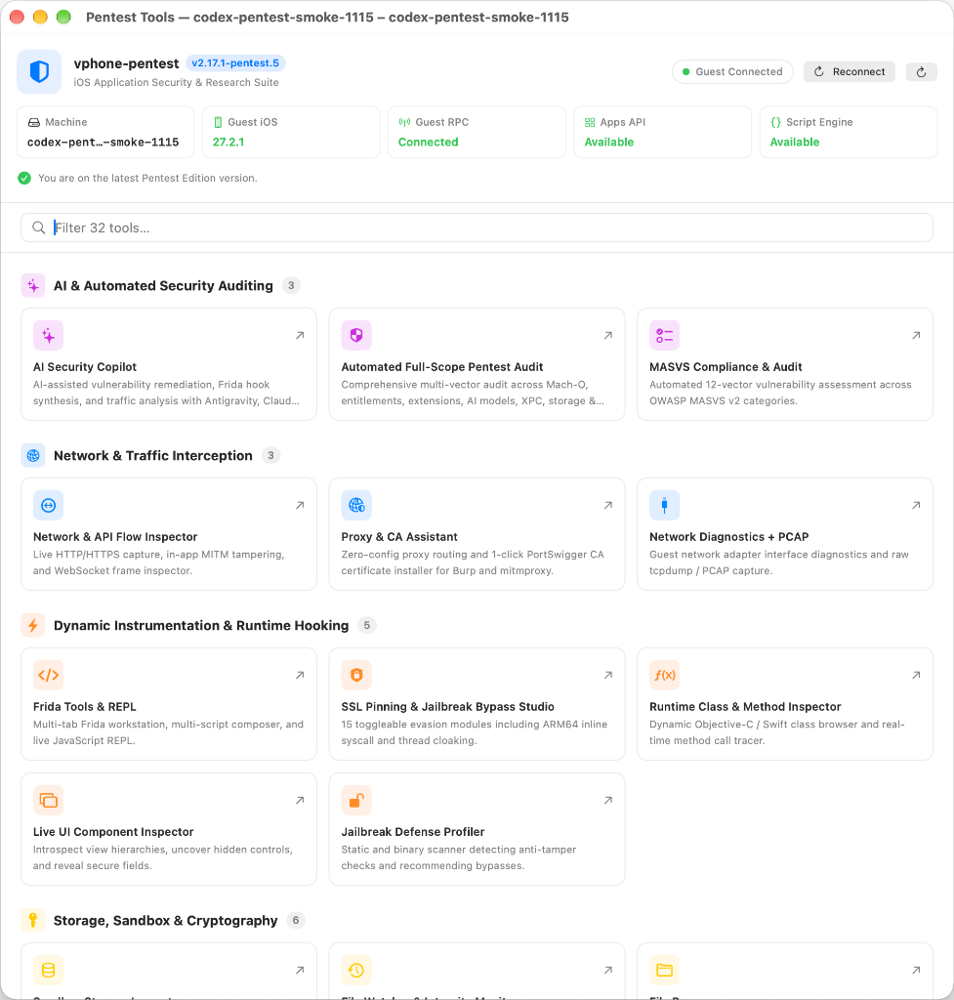

<div align="right"><a href="Documents/en/README.md">Docs</a> · <strong>English</strong> · <a href="Documents/zh/README.md">中文</a> · <a href="Documents/ja/README.md">日本語</a> · <a href="Documents/ko/README.md">한국어</a></div>

# vphone-cli (Pentest Edition)

[](https://github.com/NonBytes/vphone-pentest/releases/latest)
[](LICENSE)
[-lightgrey.svg)](https://support.apple.com)

Run a virtual iPhone or iPad on an Apple Silicon Mac for security research, reverse engineering, and mobile application penetration testing.

This is [NonBytes' fork](https://github.com/NonBytes/vphone-pentest) of [Lakr233/vphone-cli](https://github.com/Lakr233/vphone-cli), supercharged into a complete, workstation-class iOS security testing laboratory with **33 integrated pentest tools**, unified system camera with 4-way rotation, guest SOCKS5 pivoting tunnel, and automated Frida instrumentation.

> 🚀 **Quick Download**: Grab the pre-built binaries from [Latest Releases](https://github.com/NonBytes/vphone-pentest/releases/latest) without compiling:
> - [`vphone-launchpad-v2.17.1-pentest.6-arm64.zip`](https://github.com/NonBytes/vphone-pentest/releases/latest) (Workstation GUI app)
> - [`VPhone-v2.17.1-pentest.6.zip`](https://github.com/NonBytes/vphone-pentest/releases/latest) (Core Virtualization Bundle)

> [!WARNING]
> This project has never issued or authorized any cryptocurrency or token, and does not accept cryptocurrency payments or donations. Any cryptocurrency or token issued or promoted in this project's name, or claiming any affiliation with it, is a scam.




A physical Apple Silicon Mac with macOS 15+ (Sequoia) is required. The shipped apps need **no Xcode, Python, or Homebrew at runtime**. See the [documentation site](https://lakr233.github.io/vphone-cli/), [Host Setup](Documents/en/get-started/host-setup.md), and [manual](Documents/en/README.md) for base requirements.

---

## ⚡ Key Highlights of the Pentest Edition

1. **33 Integrated Mobile Pentest Tools**: Native AppKit/SwiftUI security suite covering network flow tampering, memory scanning, keychain injection, storage SQL editing, live UI revealer, and App Store + `vphone-apps` installation.
2. **On-Device AI & Advanced Security Audits**: CoreML / TFLite / ONNX model security scanner, XPC & Mach service attack surface auditor, and FairPlay decrypted IPA memory exporter.
3. **Native GPU Camera & Hardware Mocking**: Unified 4-way hardware-accelerated camera rotation (`Cmd+Ctrl+R`), synthetic battery/thermal controls, Face ID/Touch ID simulator, and foldable hinge postures.
4. **APFS Instant Snapshots & Safe Malware Mode**: Zero-copy instant VM checkpointing via APFS copy-on-write (`clonefile`) with 1-click rollback and auto-snapshot before launching untrusted apps.

---

## Prepare your Mac

Before installing, prepare your Apple Silicon Mac for research guests and select an APFS volume for the VM library:

1. Shut down the Mac. Hold the power button until startup options appear, then choose **Options → Continue** to enter macOS Recovery.
2. Open **Utilities → Terminal** in Recovery and run:

   ```sh
   csrutil enable --without debug
   csrutil allow-research-guests enable
   ```

   This keeps SIP enabled with debugging restrictions relaxed and enables Research Guests.
3. Restart into macOS. On first launch of `vphone-launchpad.app`, complete **Host Setup** to authorize Developer Tools access and install the helper.

---

## Quick Setup with an AI Agent (Recommended)

Clone the repository, open the workspace in your AI agent (Antigravity, Claude Code, Cursor, Codex), and paste:

```text
Build and install VPhone Launchpad from this repository following README.md and Research/Host/fork_build.md:
1. Check macOS, Apple Silicon, Xcode (iPhoneOS SDK), and local code-signing identity.
2. Build, sign with the local identity, verify, and install to /Applications.
3. Launch the app and verify Host Setup via vphone-launchpad-cli status.
4. If a VM name is provided (<vm-name>), start it and open Pentest Tools via vphone-launchpad-cli vm pentest <vm-name>.
```

---

## Manual Installation

1. Clone the repository:
   ```sh
   git clone https://github.com/NonBytes/vphone-pentest.git
   cd vphone-pentest
   ```

2. Build Launchpad and sign with your local code-signing identity:
   ```sh
   xcodebuild -project VPhoneLaunchpad/VPhoneLaunchpad.xcodeproj \
     -scheme VPhoneLaunchpad -configuration Release \
     -destination 'platform=macOS,arch=arm64' \
     -derivedDataPath .build/XcodeLaunchpad build

   app=.build/XcodeLaunchpad/Build/Products/Release/vphone-launchpad.app
   zsh VPhoneLaunchpad/Build/SignLaunchpad.sh "$app" '<signing-identity>'
   codesign --verify --strict --deep "$app"
   ```

3. Copy `vphone-launchpad.app` to `/Applications` and complete **Host Setup**.

4. (Optional) To build the Core Bundle from source:
   ```sh
   zsh scripts/build-bundle.zsh
   /Applications/vphone-launchpad.app/Contents/MacOS/vphone-launchpad-cli bundle install-local .build/XcodeBundle/Build/Products/Release/VPhone.bundle
   ```

---

## 💻 Headless Pentest CLI & AI Agent MCP Integration (CI/CD)

The Core Bundle ships native `vphone-cli pentest` subcommands for headless security regression testing, automated binary analysis, and AI agent integration:

```sh
# 1. Run full-scope audit in CI/CD pipeline (fails build if High/Critical risks found)
vphone-cli pentest audit <machine> --bundle-id <bundle-id> \
  --html-out audit-report.html \
  --json-out audit-report.json \
  --fail-on high

# 2. Inspect Mach-O compiler hardening flags (PIE, stack canary, ARC, FairPlay, W^X)
vphone-cli pentest binary-check <machine> --bundle-id <bundle-id>

# 3. List all installed user/system apps inside guest
vphone-cli pentest list-apps <machine> [--json]

# 4. Run native Stdio MCP Server for external AI Agents (Antigravity / Claude / Cursor / Codex)
vphone-cli pentest mcp
```

Connect your AI agent in `claude_desktop_config.json` or `.cursor/mcp.json`:
```json
{
  "mcpServers": {
    "vphone": {
      "command": "vphone-cli",
      "args": ["pentest", "mcp"]
    }
  }
}
```

---

## 🛠️ Integrated Pentest Tools

Access all tools via **Actions → Pentest Tools…** in VPhone Launchpad, or directly within any running VM window via **Right-Click → Pentest Tools** (or shortcut `⌃⌘P`).

### 🌐 Network & Traffic Interception
| Tool | Capabilities |
| :--- | :--- |
| **In-App Network & API Flow Inspector** | Live HTTP/HTTPS capture via `NSURLSession`/`WKWebView` hooks without proxy setup. In-app MITM Intercept On/Off (pause, edit & forward live requests), bidirectional WebSocket frames inspector (`NSURLSessionWebSocketTask`), pretty JSON viewer, 1-click **Copy as cURL**, request tampering & replay engine (`[Replay]`), HAR 1.2 export, and plaintext raw HTTP/S dump export. |
| **HTTP/S Parameter Fuzzer & Auto-Repeater** | Automated payload fuzzer for query parameters, headers, and JSON bodies. Presets for IDOR, Path Traversal, SQLi, XSS, Command Injection, and Boundary tests with response baseline anomaly detection (`⚠️ Anomaly`) and CSV export. |
| **Zero-Config Proxy & Burp Assistant** | Automatic system-wide and per-app proxy routing for Burp Suite and mitmproxy. 1-click PortSwigger Root CA certificate import into guest `trustd` store with active connection reachability verification. |
| **Guest SOCKS5 Pivoting Tunnel** | In-guest SOCKS5 proxy (`socks5://<guest-ip>:1080`) allowing host-side penetration testing tools (Burp Suite, Nmap, curl, browsers) to route traffic through the virtual device into private intranets/VPNs. |

### ⚡ Dynamic Instrumentation & Runtime Hooking
| Tool | Capabilities |
| :--- | :--- |
| **Runtime Class & Method Inspector** | Dynamic Objective-C and Swift `@objc` class explorer with categorization (`Security`, `App`, `System`). Real-time method call tracer recording arguments, return values, and latency, plus 1-click return value override hooks. |
| **SSL Pinning & Jailbreak Bypass Studio** | Comprehensive evasion studio with 15 toggleable modules across 5 categories: Jailbreak, SSL Pinning, Anti-Debug, Biometrics, and **Anti-RASP & Stealth** (ARM64 inline `svc #0x80` syscall neutralizer, Frida thread cloaking, runtime string de-obfuscator, code signature & text section integrity spoofing). |
| **Automated Jailbreak Defense Profiler** | Static & binary scanner detecting anti-jailbreak checks (files, URL schemes, dyld, ptrace/sysctl, fork, inline `svc #0x80`). Evaluates defense posture and provides 1-click "Apply Recommended Bypasses" into auto-hook profiles. |
| **Live UI Component Inspector & Hidden View Revealer** | Real-time Frida UI introspection dumping view hierarchies with frames, visibility (`isHidden`, `alpha`), and secure text flags. Detects hidden containers and provides 1-click live "Reveal View", "Enable Control", and "Reveal All Hidden Views". |
| **Auto-Hook on App Launch** | Configurable per-bundle automation profiles executing tailored Frida scripts (SSL pinning, JB bypass, biometrics bypass, keychain query loggers) immediately upon regular launch or safe launch. |
| **Frida Live REPL & Snippet Manager** | Multi-tab Frida workstation (Server manager, Multi-script composer, Interactive JavaScript REPL). Includes persistent snippet manager with templates for deep links, keychain queries, and network hooks. |

### 📂 Storage, Sandbox & Cryptography
| Tool | Capabilities |
| :--- | :--- |
| **Storage Inspector & Live SQLite Editor** | In-app SQLite 3 query console with live database mutations committed directly back to the guest sandbox. Automated sensitive column scanner (`⚠️` badges for password, token, pin, ssn), Plist/JSON editor, and direct export to Mac. |
| **Guest File Browser** | Full-featured guest filesystem manager: double-click folder navigation, history navigation, editable path bar, quick presets (`App Data`, `Bundles`, `Mobile Home`, `DCIM`, `Root`), Mac upload/download, and deep-link file reveals from inspectors. |
| **Keychain Inspector, Injector & Token Forger** | Complete Keychain lifecycle management: dump stored secrets, edit values (`SecItemUpdate`), delete items (`SecItemDelete`), and inject new items (`SecItemAdd`). Includes Token Forger presets (Admin JWT, UUID) and fixes iOS 27.2+ `securityd` eligibility. |
| **Sandbox File Watcher & FIM** | Real-time filesystem operation monitor (`Documents/`, `Caches/`, `Preferences/`, `tmp/`). Automatically flags plaintext JWTs, API keys, unencrypted SQLite DBs, and sensitive plists, with MASVS-STORAGE export. |
| **Dynamic Crypto Tracer & Key Sniffer** | Dynamic cryptanalysis engine hooking `libcommonCrypto` (`CCCrypt`, `CCHmac`). Intercepts AES, DES, RC4 keys, IVs, plaintexts, and ciphertexts on the fly, flagging ECB modes and weak keys. |
| **App Extensions & Shared Container Auditor** | Audits `.appex` bundles (Share, Action, Keyboard, Widgets) for security flaws (e.g. `RequestsOpenAccess = YES`, overly permissive `TRUEPREDICATE` share rules) and inspects shared App Group containers. |

### 🤖 AI Security Copilot & Automated Auditing
| Tool | Capabilities |
| :--- | :--- |
| **AI Security Copilot (Multi-Provider & Local LLM)** | Multi-provider AI assistant supporting **Antigravity (Gemini)**, **Claude (Anthropic)**, **Codex / OpenAI**, **Kimi (Moonshot)**, **Ollama (Local LLM)**, and **OpenRouter**. Provides context-aware vulnerability remediation, automated Frida hook synthesis, and native Model Context Protocol (MCP) server for autonomous agents. |
| **1-Click Automated Full-Scope Pentest Auditor** | End-to-end automated assessment scanning Mach-O hardening flags, private entitlements, App Extensions, On-Device AI models, XPC services, sandbox databases, and anti-jailbreak defenses. Calculates CVSS v3.1 scores, letter grades (A+ to F), and exports executive HTML/Markdown reports. |

### 🔍 Binary Analysis, AI & Security Auditing
| Tool | Capabilities |
| :--- | :--- |
| **App Inspector & Tech Stack Scanner** | Inspects Bundle ID, entitlements, URL schemes, and ATS rules. Automatically identifies app tech stacks (Native Swift/ObjC, Flutter Dart AOT, React Native Hermes, Unity IL2CPP) and commercial RASP/Protectors (DexProtector, iXGuard, Promon, Talsec). |
| **CoreML & On-Device AI Model Security Auditor** | Recursively scans app bundles for `.mlmodelc`, `.mlpackage`, `.tflite`, and `.onnx` models. Audits encryption status, prompt/secret leakage in metadata, exposed classification labels, and exports Markdown reports. |
| **XPC & Mach Service / Entitlements Auditor** | Analyzes declared app entitlements (flagging `com.apple.private.*`, `get-task-allow`, keychain groups) and scans Mach-O binary strings for referenced Mach service daemons and raw IPC APIs (`bootstrap_look_up`). |
| **Decrypted IPA Exporter (FairPlay Memory Dump)** | Detects Mach-O encryption (`LC_ENCRYPTION_INFO_64`), dumps decrypted executable slices from live process memory via Frida, zeroes `cryptid`, and packages a ready-to-analyze decrypted `.ipa`. |
| **Mach-O & Entitlements Security Visualizer** | Interactive 64-bit Mach-O binary inspector: visual hardening status grid (PIE, Stack Canary, ARC, W^X stack, FairPlay cryptid), search & danger rating for sensitive entitlements, dynamic library & RPATH search paths, load commands viewer, and raw XML export. |
| **Binary Diffing & Baseline Scanner** | Compares Base/Production against Target/Staging binaries. Automatically flags compiler hardening regressions, dropped protections, privilege escalations, and injected dylibs (e.g. FridaGadget). |
| **1-Click MASVS Audit & Executive Report Generator** | Automated 12-vector vulnerability assessment across OWASP MASVS v2 categories. Computes score (0–100%) and Grade (A+ to F), generating standalone responsive HTML and Markdown executive reports. |

### 🛡️ Fuzzing, Hardware & System Controls
| Tool | Capabilities |
| :--- | :--- |
| **APFS Instant Snapshots & Safe Malware Mode** | Zero-copy instant VM checkpointing via APFS copy-on-write (`clonefile`). Timeline management, 1-click rollback, and "Safe Launch" capturing an auto-snapshot before launching suspicious apps. |
| **Deep Link & URL Scheme Automated Fuzzer** | Fuzzes custom URL schemes and Associated Domains across 8 OWASP injection vectors (XSS, Path Traversal, SQLi, Buffer Overflow) with active process crash detection. |
| **Live Exception & Crash Signal Monitor** | Real-time crash monitor capturing native signals, fault addresses, ARM64 register state (`PC`, `LR`, `SP`, `FP`), and symbolicated backtraces. |
| **App Memory Search & Secret Hunter** | Live process RAM scanner (`rw-` ranges) searching for leaked JWTs, private keys, API secrets, passwords, and credit cards with interactive 64-byte Hex & ASCII dump preview. |
| **Pasteboard Inspector & Fuzzer** | Monitors `UIPasteboard` for leaked credentials and allows 1-click clipboard injection of categorized security payloads (Unicode, RTF, JSON, format strings). |
| **Device Environment & Hardware Mocking Hub** | Real-time synthetic battery (percentage, charging state), thermal status simulation, Face ID/Touch ID biometric outcome mocking, and foldable hinge posture simulation (0° to 180°). |

### 📦 Local IPA & App Store Pipeline (`vphone-apps`)
| Tool | Capabilities |
| :--- | :--- |
| **App Store & `vphone-apps` Installer** | Live Apple App Store search across regions (`US`, `TH`, `JP`, `GB`, `SG`, `DE`, `KR`, `AU`) integrated with **[securityvoid/vphone-apps](https://github.com/securityvoid/vphone-apps)** (`ipatool` + `unfairplay` + `vphone.sock`). Downloads App Store IPAs, removes FairPlay encryption on your Mac without needing a physical iPhone, and installs & launches them directly in the running VM. |
| **Patch IPA with Frida Gadget** | Injects `FridaGadget.dylib` into an unencrypted IPA, adds the Mach-O load command, embeds the listener config + token, re-signs ad hoc, and deploys directly to the virtual iPhone. |

#### Installing Apps from the App Store via `vphone-apps`
`vphone-apps` is **bundled directly inside `vphone-launchpad.app` and `VPhone.bundle`** (`CLI: Bundled`) — no Homebrew installation required.
1. Open **Pentest Tools → App Store & `vphone-apps` Installer**.
2. Click **`1. Sign In (vphone-apps login)`** and **`2. FairPlay Setup (vphone-apps setup)`** to authenticate and complete one-time FairPlay enrollment directly inside the in-app interactive console.
3. Search for any App Store app (or enter a Bundle ID) and click **`Download, Decrypt & Install to <vm-name>`**.

*(Optional standalone CLI usage via Homebrew)*:
```sh
brew install securityvoid/tap/vphone-apps
vphone-apps login && vphone-apps setup
vphone-apps install --id <bundle-id> --vm <vm-name> --purchase --launch
```

---

## ⌨️ VM Controls & Hotkeys

| Shortcut | Action | Description |
| :--- | :--- | :--- |
| `⌃⌘R` (`Ctrl+Cmd+R`) | **Cycle Camera Rotation** | Rotates camera feed 90° clockwise (`0° → 90° → 180° → 270°`) via native GPU pipeline |
| `⌃⌘P` (`Ctrl+Cmd+P`) | **Open Pentest Tools** | Launches the Pentest Tools Hub for the active VM |
| `⌃⌘F` (`Ctrl+Cmd+F`) | **Open Frida Tools** | Opens the Frida Server, Session & Multi-Script Composer window |
| `⌃⌘S` (`Ctrl+Cmd+S`) | **Snapshot Manager** | Opens APFS Instant Snapshot & Rollback Manager |
| `⌃⌘Z` (`Ctrl+Cmd+Z`) | **Rollback to Snapshot** | Safely triggers instant APFS rollback to the latest checkpoint |

---

## Fork Details & Issues

See [Host-side fork fixes](Research/Host/fork_fixes.md) for changes beyond upstream, and [open an issue here](https://github.com/NonBytes/vphone-pentest/issues) for fork-specific bugs (or [upstream issues](https://github.com/Lakr233/vphone-cli/issues) for the original project).

## Acknowledgements

- [Lakr233/vphone-cli](https://github.com/Lakr233/vphone-cli), the upstream project
- [securityvoid/vphone-apps](https://github.com/securityvoid/vphone-apps), [majd/ipatool](https://github.com/majd/ipatool), and [DrWhax/unfairplay](https://github.com/DrWhax/unfairplay), for App Store search, FairPlay decryption, and VM installation
- [wh1te4ever/super-tart-vphone-writeup](https://github.com/wh1te4ever/super-tart-vphone-writeup)
- [OpenAVB](https://github.com/owngoal-dev/OpenAVB) and [OpenSEP](https://github.com/owngoal-dev/OpenSEP), the boot ROMs used by new VMs

## License

[MIT](LICENSE). Bundled third-party components retain their own license notices.
